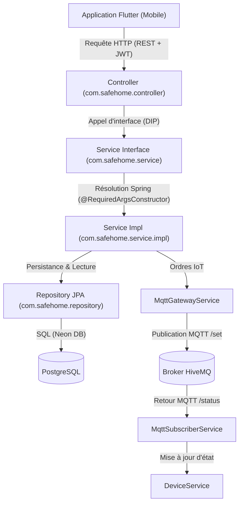

# SafeHome API - Backend Domotique & Sécurité IoT

Backend de la solution domotique **SafeHome**, développé avec **Spring Boot 4 / Java 21**, **Spring Data JPA**, **PostgreSQL (Neon DB)**, **Spring Security (JWT)** et **Spring Integration MQTT (HiveMQ)**.

---

## 🏛️ 1. Architecture & Principes de Conception

Le projet applique rigoureusement les principes **SOLID** et **Clean Code** à travers une architecture en couches étanche :

```
com.safehome
 ├── config            -> Configuration Sécurité (JWT), MQTT (Paho), DataInitializer
 │    └── security     -> Filtres JWT, JwtUtils, SecurityFilterChain
 ├── controller        -> Contrôleurs REST (points d'entrée HTTP)
 ├── dto               -> DTOs immuables implémentés en "record" Java
 │    ├── alert
 │    ├── audit
 │    ├── auth
 │    ├── device
 │    └── routine
 ├── model             -> Entités JPA & Enums
 │    └── enums
 ├── repository        -> Interfaces Spring Data JPA
 └── service           -> Contrats d'interfaces métier (DIP)
      └── impl         -> Implémentations concrètes des services
```

### Principes Clés Respectés :
1. **Single Responsibility Principle (SRP) :**
   - `DeviceService` : gère uniquement le cycle de vie et l'état en BDD des appareils.
   - `MqttGatewayService` : gère l'émission des ordres MQTT (`.../set`).
   - `MqttSubscriberService` : gère la réception asynchrone des retours d'états (`.../status`).
   - `AlertService` : gère les incidents, simulations et boutons d'urgence.
   - `AuditService` : assure la traçabilité de "qui a fait quoi et quand".
2. **Dependency Inversion Principle (DIP) :**
   - Les contrôleurs et composants ne dépendent que des **interfaces de service** (`service/`) et jamais des implémentations concrètes (`service/impl/`).
   - Injection de dépendances propre par constructeur via Lombok (`@RequiredArgsConstructor`).
3. **Records Java immuables :**
   - Tous les DTOs sont des `record` Java pour garantir l'immutabilité des données et optimiser les performances.

---

## 🔄 2. Schéma des Flux & Passation de Relais



---

## 📱 3. Couverture des 4 Écrans du Cahier des Charges

### Écran 4 : Sécurité, Utilisateurs & Audit Log
- **Authentification Stateless JWT :** Connexion unique par identifiants (pas d'inscription publique), hachage sécurisé BCrypt, token signé HMAC-SHA.
- **Rôle Unique :** `ROLE_USER`.
- **Initialisation Automatique :** Le composant `DataInitializer` injecte automatiquement au premier démarrage :
  - Identifiant : `user@safehome.com`
  - Mot de passe : `user123`
- **Journal d'Audit (`AuditLog`) :** Traçabilité horodatée de chaque action (connexion, commande d'un équipement, scénario, alerte).
- **Endpoints :**
  - `POST /api/auth/login` : Connexion et récupération du JWT.
  - `GET /api/audit` : Historique complet chronologique.
  - `GET /api/audit/user/{userId}` : Historique d'audit filtré par utilisateur.

---

### Écran 1 : Dashboard des Équipements & Passerelle MQTT
- **4 Zones Modélisées :** `SALON`, `CUISINE`, `CHAMBRE`, `GARAGE`.
- **Équipements Actionneurs & Capteurs :**
  - Actionneurs : `LIGHT` (lumières), `LOCK` (porte de garage, serrures), `SHUTTER` (volet roulant), `THERMOSTAT`.
  - Capteurs : `SMOKE_SENSOR` (fumée), `WATER_LEAK` (fuite d'eau), `PIR` (mouvement/présence).
- **Flux MQTT :**
  - Commande sortante : `safehome_charo_x789/home/{zone}/{device}/set`
  - Retour d'état entrant : `safehome_charo_x789/home/{zone}/{device}/status`
- **Endpoints :**
  - `GET /api/devices` : Liste complète des équipements.
  - `GET /api/devices/zone/{zone}` : Filtrage par zone.
  - `GET /api/devices/type/{type}` : Filtrage par type d'appareil.
  - `GET /api/devices/{id}` : Consultation d'un équipement.
  - `POST /api/devices/{id}/command` : Envoi d'ordre à un actionneur.

---

### Écran 2 : Sécurité, Alertes & Incidents en Temps Réel
- **Simulation d'Incidents (Mode Démo) :** Permet de simuler un incendie, une fuite d'eau ou une intrusion, publie l'état sur MQTT et génère une alerte.
- **Bouton d'Urgence Général :**
  - Verrouille immédiatement toutes les issues et portes de garage en base et via MQTT.
  - Émet un signal d'alarme générale sur `safehome_charo_x789/home/security/alarm`.
  - Génère une alerte critique `CRITICAL` et trace l'intervention dans l'audit.
- **Historique & Résolution :** Consultation des alertes actives ou archivées et acquittement d'incidents.
- **Endpoints :**
  - `GET /api/alerts` : Historique chronologique des alertes.
  - `GET /api/alerts/active` : Alertes non encore résolues.
  - `GET /api/alerts/zone/{zone}` : Alertes par zone.
  - `GET /api/alerts/severity/{severity}` : Alertes par gravité (`INFO`, `WARNING`, `CRITICAL`).
  - `POST /api/alerts/simulate` : Déclenchement d'un incident simulé.
  - `POST /api/alerts/emergency` : Déclenchement du bouton d'urgence.
  - `PATCH /api/alerts/{id}/resolve` : Acquittement et résolution d'une alerte.

---

### Écran 3 : Scénarios Automatiques & Routines
- **Modes Prédéfinis en 1 Clic (`PresetScenario`) :**
  - **`DEPART_ABSENCE` :** Éteint toutes les lumières, ferme le garage, baisse le volet de la chambre (0%) et arme les détecteurs de mouvement.
  - **`NUIT` :** Éteint salon/cuisine, verrouille la porte d'entrée et le garage.
  - **`SECURITE_INCENDIE` :** Déverrouille toutes les serrures et ouvre les volets à 100% pour faciliter l'évacuation d'urgence.
- **Routines Programmables :** CRUD complet et bascule rapide (activation/désactivation en 1 clic).
- **Tâches Planifiées (`@Scheduled`) :** Exécution automatique de sécurité nocturne quotidienne à 22h00.
- **Endpoints :**
  - `POST /api/routines/scenarios/trigger` : Déclenchement d'un scénario en 1 clic.
  - `POST /api/routines/scenarios/{scenario}/trigger` : Raccourci URL par nom de scénario.
  - `GET /api/routines` : Liste de toutes les routines.
  - `POST /api/routines` : Création d'une routine.
  - `PUT /api/routines/{id}` : Mise à jour d'une routine.
  - `PATCH /api/routines/{id}/toggle` : Activation / désactivation rapide.
  - `DELETE /api/routines/{id}` : Suppression d'une routine.
  - `POST /api/routines/{id}/run` : Exécution immédiate d'une routine.

---

## ⚙️ 4. Configuration & Démarrage

### Variables d'environnement requises (`.env` ou environnement système) :
```properties
PORT=8080
DB_URL=jdbc:postgresql://<neon-db-host>/safehome_db?sslmode=require
DB_USERNAME=<db_user>
DB_PASSWORD=<db_password>
JWT_SECRET=superSecretKeyWithAtLeast32BytesForHMACSHA256SafeHome
JWT_EXPIRATION_MS=86400000
MQTT_BROKER_URL=tcp://broker.hivemq.com:1883
MQTT_CLIENT_ID=safehome_backend
MQTT_TOPIC_PREFIX=safehome_charo_x789
CORS_ALLOWED_ORIGINS=*
```

### Commandes utiles :
- **Compiler le projet :**
  ```powershell
  .\mvnw.cmd compile
  ```
- **Lancer l'application :**
  ```powershell
  .\mvnw.cmd spring-boot:run
  ```
- **Construire le package JAR exécutable :**
  ```powershell
  .\mvnw.cmd clean package -DskipTests
  ```
